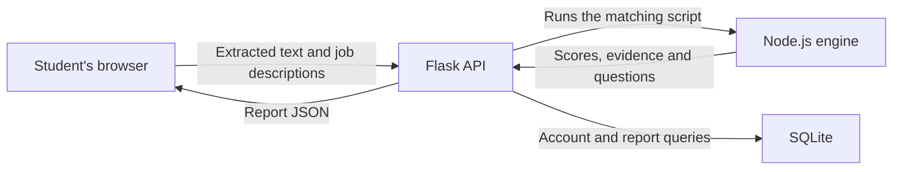

# SkillSphere · Final presentation and viva guide

## The problem and the solution

Our M5 problem statement is resume-to-job-description skill-gap analysis. A student can read several job postings and still struggle to answer three practical questions. Which role should I prepare for? Which missing skill should I tackle first? What work can I show when an interviewer asks?

SkillSphere turns a job requirement into a practice project with a test and a result the student can explain. Compare roles, identify a gap that matters across them, choose a project brief, record what you built and tested, and preview the effect of adding genuine evidence. Follow up with a role-specific interview question. The same skill can appear throughout the demo, so the judges can see a complete workflow.

## Feature inventory

| Feature | What it does | How to show it |
| --- | --- | --- |
| Resume and JD input | Reads text-enabled PDFs, supports pasted resume and JD text and accepts a text/PDF file for the first role. | Upload a synthetic two-column resume. |
| Layout handling | Rebuilds text lines from nearby PDF coordinates and splits wide gaps between cells or columns. | Open the sample report and show its source excerpt. |
| Alias matching | Counts equivalent names, such as ReactJS and React.js, as one canonical skill. | Expand React in matched skills. |
| Explainable gaps | Gives each missing skill one or more exact JD excerpts with line numbers and priority. | Expand Docker under missing skills. |
| Match coverage | Counts matched catalog skills divided by recognised JD skills. | Compare the coverage and required-skills numbers. |
| Multi-Job Comparison | Ranks up to five roles based on one resume. | Click Explore a live demo and choose one of the three reports. |
| Cross-role Skill Impact · new | Lists repeated missing skills, orders by number of roles then number of required mentions across roles, and shows a separate hypothetical lift for each affected role. | Select Docker and compare 38% → 50% and 14% → 29%. |
| From gap to project · new | Opens a chosen role's Proof Studio directly from the impact row. Every recognised gap can be selected, including gaps outside the top three. | Click Open project brief on Junior web developer. |
| Proof Studio · new | Gives a four-step brief using the skill catalog. It covers basics, a starter build, a verification task and an artifact to keep. | Ask what the student would build and how they would verify it. |
| Evidence drafting · new | Combines what the student built, how they tested it and what they observed into an editable workflow. An artifact link or filename is optional. | Fill the fields and click Draft evidence statement. |
| Proof-to-preview handoff · new | Sends the draft into Evidence Lab and asks the student to confirm the recognised skill before previewing the new coverage. | Click Review in Evidence Lab and select Docker. |
| Saved Proof Studio notes · new | Signed-in students can save and reopen one draft per report. Switching the draft to a different skill clears the fields after confirmation. | Save to this report, then reopen through My profile & history. |
| Two-week roadmap | Gives a 14-day plan for up to three priority gaps and tracks checked days. | Check one day, then save while signed in. |
| Interview Practice | Generates questions based on matched skills, missing skills, and behavioural themes. | Open a role-specific prompt. |
| STAR outline · new | Inserts Situation, Task, Action and Result into an empty answer, leaving existing answers intact. | Click Insert STAR outline and add a genuine example. |
| Student profile and report history | Creates a local account and lets signed-in students reopen or delete their own reports. | Sign in using demo details and open history. |
| PDF and JSON export | Prepares a readable print layout for Chrome's Save as PDF and provides JSON for the judge-key checker. | Open a report and show both export buttons. |

## What code runs where

- **Frontend** means what runs in Chrome. HTML creates the form and report sections. CSS styles the layout. Browser JavaScript handles the role selector, checks, preview, STAR outline and PDF print layout. PDF.js reads the text and positions in a resume PDF. Cross-role Skill Impact and Proof Studio use the returned report and existing plan rules to update instantly in the browser.
- **Backend** means what runs on the machine hosting SkillSphere. Python Flask serves the app, validates requests, manages student sessions and writes saved data. It calls the fixed `analyse.mjs` script through Node.js. The matcher recognises skill aliases, extracts evidence, ranks roles and generates the roadmap and interview prompts. The browser and server exchange JSON.
- **Database** means where saved information lives. SQLite has a `students` table for internal ID, student ID, name and password hash. One student can have several rows in `reports`. Each row stores its owner, role title, timestamp and analysis payload. The `practice` JSON field stores answers, checked days and the Proof Studio draft. Flask checks the signed-in student's ID when opening, updating or deleting a report.
- **Local vs public storage.** On your Mac, the database is `instance/skillsphere.sqlite3` inside the app folder. If deployed publicly, users would visit one HTTPS address and Flask and Node would run on the host. Set `SKILLSPHERE_DATA_DIR` to a private, persistent mounted folder on the host so SQLite and the session signing key survive restarts. The browser still extracts the original PDF locally. The host receives extracted text and job descriptions to analyse them. Saved reports include job descriptions and selected resume excerpts, along with practice drafts you choose to save. Guest analyses create no saved report rows. This ZIP runs locally and does not include a live public deployment.
- **For public launch**, keep the database and key outside public static files, use a production WSGI server behind HTTPS, and set `SKILLSPHERE_HTTPS=1` so session cookies are marked secure. Keep the database directory and key out of GitHub. The present SQLite design suits a single hosted instance with a persistent disk. Multiple independently hosted replicas would call for a shared database such as PostgreSQL and a migration. That is a future architecture option.

## Five-minute presentation for three teammates

| Time | Speaker | Slide or screen | What to say and do |
| --- | --- | --- | --- |
| 0:00–0:35 | Person 1 | Slide 1 · M5 problem | “Students read several job postings and struggle to decide where to start. A match score alone cannot tell them what to build or what to say in an interview. We built SkillSphere to connect all three.” |
| 0:35–1:20 | Person 1 | Slide 2 · Core workflow, then live demo | “We compare one resume against up to five roles. Every missing skill points to the exact job-description line.” Show the ranking, open a report, and expand a gap. |
| 1:20–2:25 | Person 2 | Live demo · Cross-role Skill Impact and Proof Studio | “One well-chosen project can prepare a student for several roles. Here Docker is a gap in two roles. Open the brief and see exactly what to build, how to test it and what to save.” |
| 2:25–3:15 | Person 2 | Live demo · Evidence Lab and interview | “After the work, the student records what happened and previews the effect on coverage. That preview depends on genuine evidence the student can show.” Generate the statement, preview it, then insert the STAR outline. |
| 3:15–4:15 | Person 3 | Slide 3 · Architecture and storage | “Chrome reads the PDF with PDF.js. Flask receives extracted text and runs our JavaScript matcher through Node. SQLite stores each signed-in student's reports and drafts. A hosted version would use a private persistent disk on the server.” |
| 4:15–5:00 | Person 3 | Slide 4 · Evaluation and takeaway | “Our practice set reached 95.8% Jaccard agreement. The official 70% requirement is measured using the judges' answer key. What our approach adds is a visible path from a requirement to a piece of work a student can show and discuss.” |

**Rehearsal flow:** Click Explore a live demo → choose Docker in Cross-role Skill Impact → open Junior web developer's project brief → enter the three demo notes below → draft → review in Evidence Lab → tick Docker → insert a STAR outline. The official brief calls for judges' live inputs. Use the example to practise and substitute the judges' resume and JDs during scoring. For one judge-provided role, demonstrate Proof Studio directly and explain that Cross-role Skill Impact appears when there are two or more roles.

Demo notes are fictional unless you have actually completed this exercise:

- What I built: “Containerised a sample web app.”
- How I tested it: “Built the image, ran it on a clean machine and opened the app in Chrome.”
- What happened: “The home page loaded on the configured port.”
- Optional artifact: `Dockerfile`.

## Questions to practise

| Question | Answer |
| --- | --- |
| What is the main innovation? | We connect shared gaps across roles to a practical project and help the student turn completed work into evidence and an interview answer. |
| Where does the evidence come from? | A gap cites the job description. A matched skill also shows resume text. A Proof Studio statement uses the student's own build, test and result notes. |
| How do you calculate coverage? | Matched recognised skills divided by all recognised JD skills. The cross-role preview adds one to the matched count for roles missing that skill. This measures coverage of recognised mentions, not skill mastery or hiring chances. |
| Are project recommendations generated by a chatbot? | No external AI runs during an analysis. The app fills rule-based learning and interview templates using skill data. OpenAI Codex assisted with project development, tests and docs. |
| Will your friend's Windows copy show your Mac history? | Each local copy has its own SQLite file. Users share the same hosted database only when using a future deployment, with reports scoped to their own account. |
| What happens to an old saved report after this update? | The existing report still opens. The new draft can be added to its practice data without adding a database table. |
| What happens with an image-only PDF? | Use an OCR-enabled copy or paste the resume text. Layout handling works on selectable text. |
| What does 95.8% mean? | It is Jaccard agreement from eight labelled practice cases. The official judging target still requires the judges' own key. |

See `PROJECT_AND_PITCH.md` for the original file-by-file explanation and `START_HERE.md` for setup.
